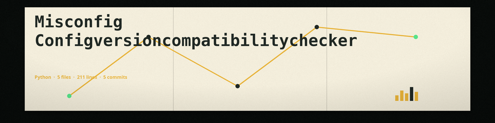

# misconfig-ConfigVersionCompatibilityChecker
Checks if the configuration file version is compatible with the running application version, preventing errors due to outdated or unsupported configuration settings. - Focused on Check for misconfigurations in configuration files or infrastructure definitions

## Compatibility rule

Versions use the `major.minor.patch` format and must be given as strings (quote the version in the configuration file if needed). A configuration version is compatible with the application version when:

- the major versions are equal, and
- the configuration version is not newer than the application version in its minor or patch component.

Any older configuration within the same major version is accepted, with no lower limit. A configuration from a different major version, or a newer minor or patch within the same major, is incompatible and the tool exits 1. A compatible check exits 0.

A configuration file whose top level is not a mapping, or whose version value is not a string in `major.minor.patch` format, is reported as a format error and exits 1.

## Install
`git clone https://github.com/ShadowStrikeHQ/misconfig-configversioncompatibilitychecker`

Install the dependencies with `pip install -r requirements.txt` (PyYAML).

## Usage
`python3 main.py -c CONFIG -a APP_VERSION -t {json,yaml} [-k VERSION_KEY] [-v]`

## Parameters
- `-h`: Show help message and exit
- `-c`: Path to the configuration file.
- `-a`: The version of the running application (e.g., 1.2.3).
- `-k`: The key in the configuration file that holds the version (default: 'version').
- `-t`: The type of the configuration file (json or yaml).
- `-v`: Enable verbose logging.

## License
Copyright (c) ShadowStrikeHQ
